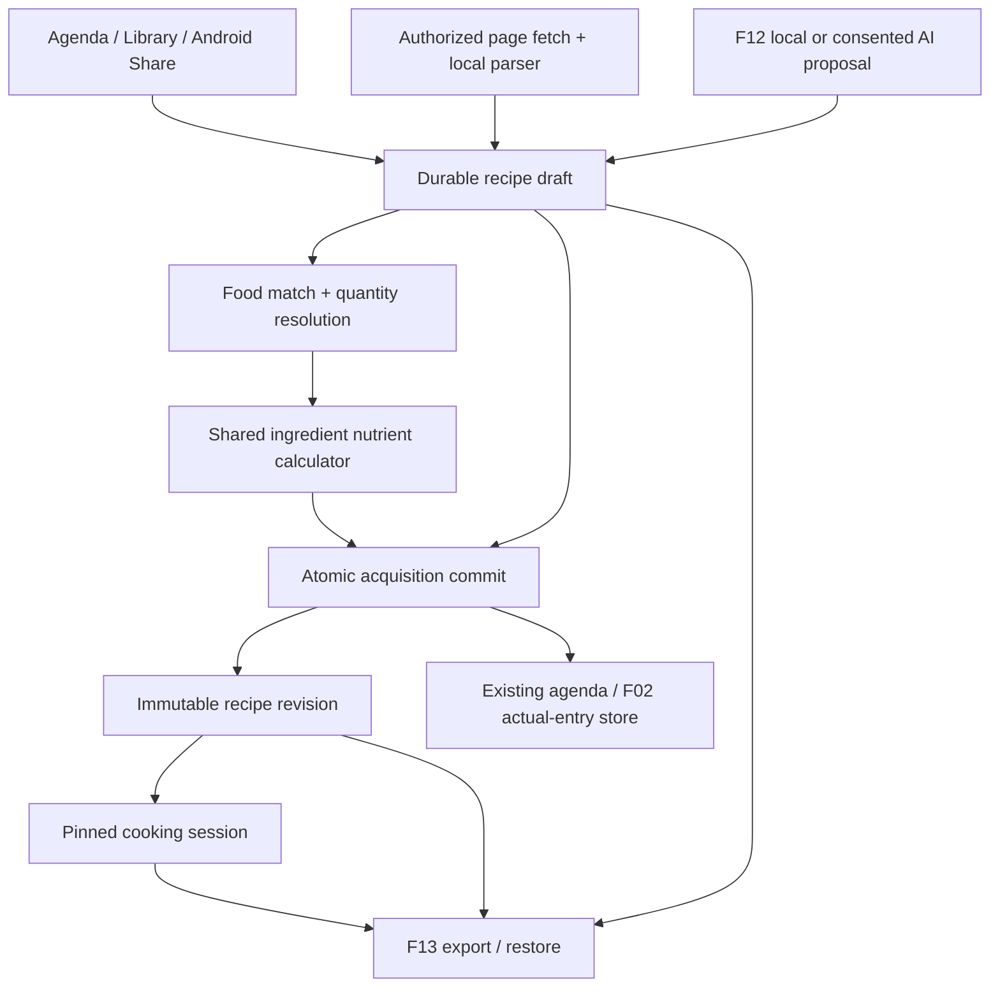
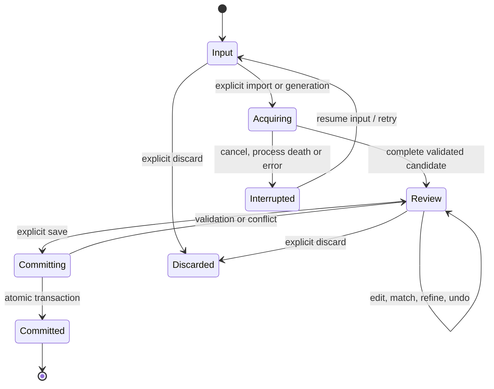

# Recipe creation, reuse and cooking — Technical Specification

WLO-0167 · 21 September 2026 · [Functional contract](../features/F03-recipe-creation.md) · [Accepted mockup](../design/flows/12-recipe-creation.html) · [UX rationale](../research/recipe-creation-ux.md).

Status: complete implementation design, with explicit external release/egress/catalog-policy gates in §15. No production implementation or native validation is claimed. “Must” describes the delivery acceptance contract; proposed type names and table names below may be adapted to repository conventions without changing invariants. Governing [FEATURES.md](../features/FEATURES.md) and [ARCHITECTURE.md](ARCHITECTURE.md) take precedence.

## 1. Current implementation and gap analysis

Inspected in this checkout on 21 September 2026:

| Existing surface | Current contract | Required evolution |
| --- | --- | --- |
| [`Planning.kt`](../../core/model/src/commonMain/kotlin/app/wlo/core/model/Planning.kt) | `Recipe` has non-null `servingsBase` and five non-null `NutritionPerServing` values; `RecipeIngredient` has grocery ID, name, qty/unit and optional flag | Nullable typed yield, stable content IDs, unresolved text, FoodItem revision/snapshot, per-nutrient completeness and attribution |
| [`Food.kt`](../../core/model/src/commonMain/kotlin/app/wlo/core/model/Food.kt) | Nullable macros, ambiguous per100g comments for liquids, `ServingPreset.grams`; no immutable food revision type | WLO-0160 explicit mass/volume basis, nutrient definitions and source revisions; do not infer from field names |
| [`RecipeRepository.kt`](../../core/data/src/commonMain/kotlin/app/wlo/core/data/RecipeRepository.kt) | Immutable `(id, version)` recipes, create/edit/archive, name-only search; edit reads latest before write | Profile-qualified revision checks in one transaction; exact-revision reads; search/metadata/drafts; atomic acquisition commit |
| [`RecipeSeed.kt`](../../core/data/src/commonMain/kotlin/app/wlo/core/data/RecipeSeed.kt) | Ingredient JSON codec and seed copy | Versioned lossless content codec and deterministic migration; no guessed FoodItem links |
| [`Entities.kt`](../../core/database/src/commonMain/kotlin/app/wlo/core/database/Entities.kt) | `recipes` stores immutable versions and JSON ingredient/step lists | Evolve existing table as authority; add draft/metadata/session/operation stores and a rebuildable search index |
| [`MealAgenda.kt`](../../core/data/src/commonMain/kotlin/app/wlo/core/data/MealAgenda.kt) | Item-granular `plan_slots`, `AgendaFood` frozen nutrient/unit snapshots, nullable coverage, idempotent item add, target/fingerprint-checked suggestion commit | Typed recipe portion adapter and atomic recipe-plus-items transaction; preserve agenda's current behavior |
| [`RecipeEditScreen.kt`](../../feature/f03-planning/src/main/kotlin/app/wlo/feature/f03/planning/ui/RecipeEditScreen.kt), [`F03Routes.kt`](../../feature/f03-planning/src/main/kotlin/app/wlo/feature/f03/planning/F03Routes.kt) | Existing editor and route in F03 | Shared durable draft editor, acquisition/library/details/cooking routes; keep existing edit deep links working |
| [`EgressPort.kt`](../../core/ports/src/commonMain/kotlin/app/wlo/core/ports/EgressPort.kt) | Explicit purposes for downloads, food lookup, diagnostics and consented future AI | Website retrieval is not allowed by an existing purpose; add an approved non-AI purpose/policy before enabling |
| [`WloDatabase.kt`](../../core/database/src/commonMain/kotlin/app/wlo/core/database/WloDatabase.kt), [`BackupSchema.kt`](../../core/vault/src/commonMain/kotlin/app/wlo/core/vault/BackupSchema.kt) | Room 11, backup schema 2 | Next available versions with staged migrations, fixtures and round-trip restoration; do not reserve version numbers across unrelated work |

The browser mockup's localStorage, fixture matching, fixed AI response, example.com import, one draft and DOM controls are demonstration scaffolding. Do not port these as production behavior. Multi-draft recovery, real import/generation, typed units and native accessibility require the contracts below.

## 2. Architecture and ownership



- `:feature:f03-planning`: MVI-style screen state, intents, UI validation messages, navigation restoration and presentation. Split library, draft editor, acquisition and cooking state holders; do not expand the legacy PlanViewModel into a single all-purpose controller.
- `:core:model`: serializable recipe content, typed yield/portion, revision references, nutrient result/provenance vocabulary and cooking-session value types. No Android or network dependencies.
- `:core:engines`: pure deterministic ingredient parsing/matching policy, quantity conversion and nutrient calculation. Reuse the F02/WLO-0157 engine; F03 formats results rather than recalculating them.
- `:core:data`: repositories, transaction coordinator, draft mutation/revision checks, mapping to existing agenda/diary stores, persisted job state and search-index updates. Repository APIs return `WloResult` and observable `Flow` consistent with current code.
- `:core:database`: Room entities/DAOs/migrations; no parsing or product policy inside DAOs.
- `:core:ports` + F12/runtime adapters: generation and bounded page-fetch interfaces. `:core:network` remains the socket owner; feature code cannot open sockets or hide fetches in a WebView.
- `:core:vault`: versioned backup/share bundles, staged validation/remapping, secret exclusion. `:app` wires Android Share, navigation and dependencies; no feature-to-feature dependency to F02/F12 screens.

All repositories qualify access by active `profileId`, including exact revision, archive, favorite, link resolution, search and idempotency lookup. Never trust profile IDs in shared content. All I/O/parsing runs off the main thread. UI shows immutable snapshots; async results carry a draft revision/job token so stale work cannot apply.

## 3. Domain and storage contract

### 3.1 Identities and revision envelope

Evolve `recipes`, do not introduce an alternative recipe authority. Add an identity/metadata table if needed for mutable library state; `(recipeId, version)` remains the immutable content key. All IDs are local UUIDs except source-qualified external references. Domain revisions use the existing `version` naming consistently.

| Record | Required fields and invariants |
| --- | --- |
| Recipe identity/metadata | `profileId`, `recipeId`, created/last-content-saved timestamps, currentVersion, favorite, personalNotes, metadataRevision, archivedAt. Notes/favorites change metadata, not nutrition or content version. |
| Recipe content version | `profileId`, `recipeId`, version, contentSchemaVersion, title, yield specification, ordered sections/ingredients/instruction blocks, source/ancestry, reference links, optional times/tags, nutrient calculation snapshot, optional publisher/legacy claims, createdAt, contentHash. Immutable after commit. |
| RecipeDraft | `draftId`, profileId, schemaVersion, monotonically increasing draftRevision, acquisition kind, stage, input/source text, editable content, optional base recipe/version and metadataRevision, protected edits, destination, preview context versions, undo history, job reference, created/updated timestamps. Never returned by saved-recipe search. |
| AcquisitionOperation | `(profileId, operationId)` unique, frozen command hash, draftId/revision, committed recipe/version IDs, item IDs, committedAt. Ledger record and all result writes share one transaction. |
| CookingSession | sessionId, profileId, recipeId/version plus pinned content/notes snapshot, batchScale, checked ingredient IDs, current step ID, scroll anchor/offset, sessionRevision, started/updated/ended timestamps. One active session per profile initially. |
| Search document | profileId, recipeId/currentVersion, normalized name/ingredient/source terms, sort timestamp; derived and rebuildable. No duplicate recipe authority. |

`currentVersion` updates use compare-and-set against the editor's base version. Recipe content and food snapshots are retained while referenced by any plan, diary entry, version, draft or session. Archive does not cascade delete history. Permanent user erasure remains F13's explicit operation.

### 3.2 Content fields

Each ingredient stores:

- Stable `ingredientId`, `sectionId?`, order; source/original text and current editable text; preparation note, optional flag and included boolean. New optional rows default included until explicitly excluded. An excluded row remains visible but is omitted from nutrient/shopping inputs with a recorded reason.
- Parsed amount as a finite positive decimal when resolved, canonical unit/dimension, original quantity text and optional alternatives/range. “To taste”, a range or conflicting alternatives are unresolved rather than zero or a chosen midpoint. Zero quantities are invalid; use exclusion to omit a line.
- Independent `groceryItemRef?` and `foodRevisionRef?`. Grocery identity is not evidence of food nutrition. Recipe content may be saved with either missing.
- `foodSnapshot?`: source-qualified ID/release/content hash, profile-owned selection revision, food name/state, explicit denominator and nutrient observations required to reproduce this revision. Include the selected conversion record and its source/revision.
- Resolution status/reasons: `unmatched_food`, `ambiguous_food`, `unknown_quantity`, `unknown_basis`, `missing_conversion`, `pending`, `invalid_input`, `unsupported_component`. Missing one nutrient is a nutrient-level reason rather than a food-match failure.
- Field provenance/origin (`user`, `import`, `local_parser`, `ai`) and protected-field revisions. A user-corrected food choice cannot be replaced by subsequent parsing without explicit choice.

Sections have stable IDs, titles and order. Ingredients have a section reference and ordering within it; headers never masquerade as ingredient rows. Instruction sections/steps also have stable IDs/order and plain text. Preserve source instruction text and optional safe reference links separately; no HTML is rendered as executable content.

Source attribution includes acquisition kind, original submitted URL, final fetched URL, declared canonical URL when present, author/publisher, capturedAt, optional upstream dates/license, source candidate ID, parser version, source content hash and original recipe fields. Canonical URL is untrusted metadata, not permission to fetch. Variations include parent recipe/version and original attribution. Unknown license stays null. AI authorship persists after saving; “draft” is a lifecycle state, not a provenance value that disappears on commit.

Keep recipe navigation links separate: `{linkId, targetRecipeId, labelOverride?, sourceUrl?}`. Resolve within the profile; a deleted/unavailable target has an explicit unavailable state. No graph expansion or nutrient contribution occurs. Unsupported counted source ingredients are retained with a resolution reason. The future counted type must explicitly pin child version and supported amount/basis, reject cycles and avoid counting child and leaves twice; it is not enabled by this schema increment.

### 3.3 Yield and portions

`RecipeYield` contains preserved source wording and zero or more established output bases. Unknown yield is an empty set, not an implicit batch serving:

| Basis | Value | Constraint |
| --- | --- | --- |
| `serving` | Positive finite servings in original batch | “4–6” remains unresolved until explicitly set |
| `count` | Positive count + stable count label/ID, e.g. cookies | Do not equate a cookie with a meal/serving |
| `mass` | Positive grams of final edible cooked output | Cannot infer from raw ingredient total |
| `volume` | Positive ml of final output | Cannot infer from mass without a recorded recipe-specific conversion |

Each basis includes origin/evidence. Several bases can coexist only as declared equivalents for this same batch; editing/scaling must preserve or invalidate those relationships explicitly. `RecipePortion` is a positive amount plus a supported yield basis ID. A 200 g portion of an 800 g cooked batch uses fraction `200/800`; a 3-cookie portion of 12 cookies uses `3/12`. Unsupported basis is an error with a correction route. Do not expose “one serving” when yield is unknown. Original-batch viewing remains available in cooking; this delivery does not add a whole-batch shortcut to bypass missing meal portion basis.

Use decimal text serialization for author-entered amounts and explicit numeric conversion in calculations; never JSON NaN/Infinity. Retain original precision and round only in presentation. Existing finite Double values can be converted to a canonical decimal representation during migration without claiming extra measurement precision.

### 3.4 Nutrients and immutable calculation snapshot

Consume WLO-0160's observation semantics: definition, value status (`known`, `unknown`, `trace`, `less-than`, `invalid`), derivation (`reported`, `converted`, `estimated`), unit, source method and denominator. At minimum persist energy, protein, fat, carbohydrate definitions, fiber and R-A4 sugar/sodium when supplied. Never silently drop sugar/sodium because the old five-value model cannot hold them.

Calculation snapshot includes calculatorVersion, normalizationPolicyVersion, carbohydrate convention, ordered included ingredient IDs/input hashes, selected food/conversion snapshots, per-ingredient results/reasons, complete batch results, optional per-yield results and contentHash. Missing results are typed, not numeric sentinels. A cache may be rebuilt only from these pinned inputs with the pinned policy; app upgrades do not replace historical results implicitly.

Website and pre-migration recipe totals are `ExternalNutritionClaim`s with explicit source and declared basis, independently retained. They cannot fill missing ingredients in the primary calculator. Existing historical diary/plan snapshots remain as recorded and retain their actual legacy provenance.

### 3.5 Persistence choice

Keep versioned content as schema-versioned JSON in the existing recipe version table, with indexed scalar identity/title/profile/version/time columns and queryable identity/metadata. Migrate/drop obsolete non-null macro columns or make them nullable compatibility projections; they must not demand invented zeroes to save. Use one authoritative content codec, also consumed by vault and tests. No permanent dual-write of competing old/new recipe models.

Use a dedicated `recipe_drafts` table for draft envelopes, `recipe_operations` for idempotency, `recipe_cooking_sessions` for progress and a rebuildable indexed search table. Food revision storage belongs to WLO-0160. Foreign references inside JSON require repository and restore validation, since Room cannot enforce them as foreign keys. Ingredient/step IDs remain stable within a recipe lineage; copying to a new recipe may preserve internal IDs scoped by recipe ID, with all internal references rewritten consistently.

## 4. Nutrition and normalization algorithm

1. Read a pinned recipe content version or current draft revision, normalization policy and selected food snapshots. Filter explicitly excluded rows; section headers/reference links never enter the calculator.
2. For each included ingredient, validate food state, amount and unit. Normalize compatible mass units to g and volume units to ml. Resolve a food-specific portion/count or density conversion only from a selected, sourced conversion. Preserve the conversion path.
3. Map nutrient definitions to the declared policy before summation. Do not combine carbohydrate including fiber with carbohydrate excluding fiber. The policy decision is owned by WLO-0159/WLO-0160; locale changes must not switch it. If the required conversion is unavailable, that nutrient remains unknown.
4. For each usable nutrient `n`: `contribution[n] = amountInFoodBasis / denominatorAmount × observation[n]`. Energy uses the selected source energy/method, not a newly invented 4/4/9 total. Trace/upper-bound values remain non-exact; first delivery holds the exact aggregate and shows why.
5. If any included row has unresolved food/quantity/basis/conversion, set recipe presentation readiness to incomplete and suppress the primary nutrient totals/per-serving panel under F03's gate. Retain explicitly labelled known contributions in the explainer. If all rows resolve but one nutrient is missing, hold that nutrient only; do not erase other complete nutrients.
6. Sum complete contributions without intermediate display rounding. Batch math does not require yield. For a supported output basis: `portion[n] = completeBatch[n] × portionAmount / batchYieldAmount`. Publish results only when the input hash still matches the editor revision.
7. Freeze the result and inputs at commit. Convert held nutrients to null in the agenda's snapshot while retaining completeness/provenance metadata. Extend agenda/F02 nutrient vectors for new shared nutrients together; never treat omitted fields as zero. Target-fit requires complete coverage for every nutrient used by that fit rule.

Examples are fixtures, not nutrition advice: 150 ml at 60 kcal/100 ml is 90 kcal. The same amount entered as 150 g is held without density. A 1,200 kcal batch yielding 4 servings contributes 450 kcal for 1.5 servings. If it also has an established 800 g output, 200 g contributes 300 kcal. An unresolved included “oil to taste” holds the primary recipe panel even if all other lines are known; explicitly excluding the oil allows recalculation with that exclusion shown.

Changing recipe yield with fixed ingredients changes per-portion math only. `ScaleBatch(factor)` multiplies resolved quantities and all established output bases together, leaves temperatures/durations untouched, and flags unscalable text/instruction quantities for review. It is an explicit draft edit; cooking-session scale is a separate display state. Included optional ingredients count; alternatives do not both count unless explicitly authored as separate included ingredients.

## 5. Draft lifecycle, editing and background work



Durable autosave and explicit save are separate. Persist input before starting acquisition, and persist validated full candidates before showing them as recoverable. All user edits pass through a serialized draft mutation queue with expected draftRevision; update observable durable state after acknowledgment. Text writes may be coalesced up to 300 ms; flush on focus loss, Back, background transition and commit. Never display “Saved” for an unacknowledged change. Process death may lose only the unacknowledged typing window, not a previously acknowledged draft. Surface storage failure and retain in-memory input for retry/copy.

After restart, interrupted parsing/generation jobs become `Interrupted`; do not automatically replay network/model calls. Keep URL/request, previous complete candidate and manual edits. A new share is durably recorded as another input draft; duplicate intent delivery within the same acquisition operation reuses its operation token. A deliberate later share starts a new attempt and runs duplicate detection.

Mutation commands carry IDs, not list positions. A parser result includes draftId, inputRevision, per-line input hash, parser version and suggested patches. Apply only to unchanged, unprotected fields. Changing a line's amount can invalidate that amount/conversion while retaining an explicitly selected food if still compatible; changing food wording invalidates the food proposal unless confirmed. Do not blank unrelated rows.

Text/row conversion uses a stable ordered document model and line association: unchanged lines retain IDs; duplicate identical lines remain distinct by occurrence/order; new lines get new IDs; deleted rows are retained in undo. Unknown text remains present. Store original raw paste plus current document. Reordering and section reassignment do not alter nutrient interpretation. Unit locale is explicit; parse common decimal commas, Unicode fractions and mixed fractions; ambiguous units/ranges stay unresolved.

Maintain bounded durable undo for the latest 20 structural edits/refinements, subject to the draft-size cap; ordinary text uses native undo while editing. Pruning never loses current content. Undo is a new draft revision. A refinement stores a patch and inverse against its base; if later edits overlap, expose selective conflict resolution instead of restoring the entire old document. Successful save clears active undo/job state. Explicit discard retains an undo tombstone for the visible Snackbar lifetime, then removes draft-only data; referenced saved content survives.

## 6. Repository APIs and atomic commit

The following signatures define responsibilities, not mandatory new module names:

```kotlin
interface RecipeDraftRepository {
    fun observe(profileId: String, draftId: String): Flow<WloResult<RecipeDraft>>
    suspend fun create(input: AcquisitionInput): WloResult<RecipeDraft>
    suspend fun mutate(id: DraftRef, expectedRevision: Long, command: DraftCommand): WloResult<RecipeDraft>
    suspend fun applyCandidate(id: DraftRef, baseRevision: Long, candidate: RecipeCandidate): WloResult<RecipeDraft>
    suspend fun discard(id: DraftRef, expectedRevision: Long): WloResult<DiscardReceipt>
}
interface RecipeAcquisitionCommitter {
    suspend fun commit(command: CommitRecipeAcquisition): WloResult<CommitReceipt>
    suspend fun receipt(profileId: String, operationId: String): WloResult<CommitReceipt?>
}
```

Extend RecipeRepository with profile-qualified exact-version reads, metadata writes with expected metadataRevision, stable-link resolution and AND-term library search. `edit` requires the expected content version. Do not retain the current read-latest/increment/write race. Add CookingSessionRepository with start/resume/mutate/end and sessionRevision checks.

`CommitRecipeAcquisition` contains profileId, operationId, draftId/revision, expected base recipe versions and metadata revision for changed notes, selected proposal item IDs, requested yield-basis portions, destination enum (`Library`, `PlannedMeal`, future `EatenMeal`), local date/meal, target/context fingerprints and explicit replacement target/version if any. No “eaten” inference from a past date. The command is immutable once dispatched.

Transaction procedure:

1. Flush edits, validate content/portion/destination and calculate from a frozen draft snapshot outside the write transaction. Retain unresolved results where saving is allowed.
2. Begin one Room write transaction. Check `(profileId, operationId)`: if already committed with the same command hash, return the existing receipt; if the hash differs, return `OperationConflict`.
3. Recheck profile ownership, draft revision, base recipe versions and destination/target fingerprints in the transaction. A changed target/context returns `ContextChanged` and keeps work; the UI refreshes explanatory context for the next explicit Save. A changed recipe returns `RevisionConflict` with compare/variation recovery. If the draft changes personal notes, compare its base metadata revision and merge only explicitly changed metadata fields; concurrent notes need conflict review. A favorite toggle is never overwritten by a stale editor snapshot.
4. Create immutable recipe versions and metadata, then all selected agenda items using stable IDs allocated for this command. For Eaten, invoke the existing F02 diary transaction path and freeze item JSON/portion nutrition. Use transaction-aware internal helpers; never commit the recipe in one repository call and the meal later in another independent transaction. Library-only save omits item writes.
5. Preserve existing sibling items and order; append selected additions. Any explicit replacement retires only its named target under existing agenda semantics. Whole-meal selected new recipes and ordinary foods share the same atomic operation. Unselected generated recipes are not silently saved; ordinary foods remain ordinary foods.
6. Write the operation receipt, search documents and completion state for the draft in the same transaction. Mark the draft committed only after all writes succeed. On any error roll back all writes.
7. Publish success through repository observation; navigation/Snackbar consume the receipt once. Process death after commit but before UI delivery recovers that receipt. A failed attempt retries the same immutable command ID/hash; a reviewed change after a precommit validation/conflict creates a new command ID. There is no automatic retry that generates new recipe/item identities.

Suggested error codes: `InvalidContent`, `UnsupportedPortion`, `StaleDraft`, `RevisionConflict`, `ContextChanged`, `ProfileUnavailable`, `OperationConflict`, `StorageFull`, `StorageFailure`. Domain codes carry row/field IDs and recovery options, never raw SQL/provider errors in product copy. Legacy planned/logged nutrition is never recalculated by this transaction.

## 7. Website and pasted-text import

### 7.1 Android entry and egress gate

Use an app-owned Android Share entry for supported `text/plain`/URL content, routed through app lock and active-profile selection. Process both initial intent and subsequent delivery; create a durable input record before navigation. Treat MIME type, text and URI as untrusted. Do not auto-read clipboard or accept executable content/remote file schemes. Photo/PDF/document imports and multi-file migration are separate features. Android's receiving guidance supports `ACTION_SEND`/shared text and review before use; wiring belongs in `:app`, not a feature-owned exported database API. [Android receiving documentation](https://developer.android.com/develop/ui/compose/sharing/receive).

**Proposed policy, requiring a master-contract amendment before enabling:** add `RECIPE_IMPORT` as a non-AI `EgressPurpose`. Authorize one explicitly initiated import request with a short-lived operation-bound grant, no persistent site permission and no seventh AI category. Before the first request, show host and that WLO will request this page; the user chooses Fetch recipe or Keep link/paste instead. This grant authorizes the page and bounded same-origin redirects only. A redirect to another origin pauses for that destination's authorization; no silent redirect-based permission expansion. Cancel, expiry, process restart, profile change or revocation invalidates the grant. Default policy denies; Pure/no-INTERNET build exposes manual/paste and saved content only.

The dispatcher, not caller-provided lambdas, must own/validate the actual URL and redirect chain for this purpose. Reject a request whose claimed host differs from the socket destination. Do not reuse OFF lookup grants, generic model download permission, cookies, browser credentials, AI keys or a cloud category for website retrieval.

### 7.2 Fetch envelope and limits

Initial engineering limits below are product bounds to validate, not upstream guarantees:

| Limit | Initial value / response |
| --- | --- |
| Schemes | HTTPS only; other links may be retained/opened externally, but are not fetched by importer |
| URL length | 8 KiB; reject over-limit request without dropping pasted text |
| Redirects | Maximum 5; validate/authorize every hop, deny HTTPS downgrade |
| Network deadline | 30 s total, 10 s connection deadline; cancelable, explicit retry only |
| Body cap | 5 MiB received and 5 MiB decompressed; streaming enforcement, no giant allocation before checking |
| Content | HTML/XHTML or JSON Recipe content; no script execution, subresources, remote JSON-LD contexts or recursive links |
| Parse budget | 2 s off-main per document, JSON nesting 32, maximum 50 recipe candidates; fail clearly on limit |
| Durable content | 256 KiB raw pasted recipe text, 1 MiB serialized draft/content payload, 500 ingredients, 300 steps, 100 sections; visible error, no silent truncation |

Reject embedded credentials, localhost, link-local, private/reserved IP destinations and hostnames resolving to them. Validate DNS/connect destinations and every redirect to avoid connecting to local services through hostile links. Never disable TLS validation. No background crawling or scheduled refresh. Invalid/unsupported/over-limit content returns a typed failure with the input retained. If body acquisition is interrupted, remove temporary bytes and keep only durable input/previous complete candidate.

Send only the authorized request URL and necessary HTTP headers; no dietary profile or user records. Do not request images, fonts, trackers or JavaScript. Store temporary response bytes in app-private cache, delete after successful extraction/cancel/error, and sweep abandoned temporary data on next launch within 24 hours. Persist only selected source recipe fields and necessary original wording, not the whole page. Receipts contain purpose, operation, authorized host, redacted path/hash, byte counts, redirects/status/duration; avoid raw query strings containing secrets. No content logging in diagnostics.

### 7.3 Deterministic parser

Pipeline: validate input → authorized fetch → find structured candidates → choose candidate → normalize content → parse ingredient suggestions → local food matching → shared editor. Parser input is bytes plus charset/content type and original URL; output is `ImportResult(candidates, warnings, source, parserVersion)` or typed failure. No network is possible inside parser/matcher.

Support JSON-LD Recipe objects in objects, arrays and `@graph`, with string/array `@type`; walk only a bounded in-document graph. Preserve candidate identity (`@id` plus source/page content hash) when available. Handle ingredient string arrays and bounded structured lists, text/HowToStep/HowToSection instructions and common textual/structured yield. Unknown structured forms remain source text with warnings. Microdata/RDFa and JavaScript-only sites fall back to paste in the first importer rather than a site-specific scraper promise. Schema.org supplies a vocabulary with varied field types, not a correctness guarantee; WLO's supported subset is explicit. [Recipe fields](https://schema.org/Recipe).

HTML fragments in selected fields are sanitized to plain text, preserving line/section boundaries and safe link labels; never run embedded code. Convert ISO-style time fields only when well-formed, retain original unsupported durations. Missing fields stay absent. Multiple candidate recipes require choice, not concatenation. Required saveable content is evaluated after extraction, not fabricated to meet the schema.

Pasted free text uses local block detection for title, ingredient headings and instructions. Preserve the entire raw paste. If classification is uncertain, show unassigned blocks with Assign to ingredients/directions/notes controls; all blocks must remain accessible even when the user saves. Do not silently turn direction paragraphs into nutrient-bearing rows or discard them. Pasted ingredients in the ingredient editor bypass document classification and remain lines/sections. AI parsing is not an automatic fallback in this delivery.

### 7.4 Duplicate detection and refresh

Compute a normalized URL key using conservative URL normalization (host case, default port, fragment removal); retain the original URL. Do not strip arbitrary query parameters or trust publisher canonical URLs as identity proof. Combine source URL/candidate ID with a normalized source-content hash for duplicate suggestions. Equal titles alone never merge identities. Multiple recipes on one page remain distinct.

An existing candidate offers Open saved, New variation or Review refresh. Refresh performs a three-way comparison: retained original source fields, current user content, new source fields. Apply nonconflicting source changes as draft proposals; protect user-corrected rows, notes and yield. Missing fields in the refreshed source do not delete user content. Save creates a new version with exact ancestry/source record; cancel changes nothing. Nutrition recalculates from resolved draft ingredients only.

Typed failures include `InvalidUrl`, `AuthorizationRequired`, `UnsafeDestination`, `Offline`, `Timeout`, `AccessRestricted`, `UnsupportedContent`, `TooLarge`, `ParseLimit`, `NoRecipeFound`, `MultipleCandidates`, `Cancelled`. Product actions always preserve input: retry, choose a candidate, paste, open the external site or edit manually.

## 8. AI generation and refinement

Define an F12-backed `RecipeGenerationPort` with `generate(request, executionPolicy)` and `refine(baseCandidate, request, executionPolicy)` returning a cancellable result/observable phase. The adapter cannot write recipes, food rows or diary data. Request contains operation/draft/base revision, prompt, scope, people/yield/time constraints, explicit exclusions, optional day target/coverage and narrowly scoped existing meal context. Dates/targets are informational, not model authority to choose the commit destination.

Prefer a capable installed local model; a deterministic saved-recipe suggestion engine is a disclosed fallback, not claimed novel recipe generation. A model is selectable only when its adapter supports the output contract and passes the validation corpus. Downloads/setup use F12/R-S14; no model is presumed bundled. Device memory/latency failures retain input and offer non-AI paths. Model selection and benchmark evidence are release gates, not an unfinished algorithm decision hidden in the UI.

Cloud request execution requires F12 `meal-planning` grant, BYOK configuration, payload preview, dispatcher and receipts. The payload contains only the request, applicable constraints and previewed meal/target context; no weight history, unrelated diary, gut records or hidden notes. Anything crossing the device boundary, including a LAN model server, is treated as egress. User edits after the preview invalidate that preview. Revocation cancels transport and prevents late output from applying; received partial output is discarded. Local input and earlier complete proposals survive.

### Output schema version 1

A bounded JSON object with:

- `schemaVersion`, proposal title, scope and `items[]` (maximum 8 in whole-meal mode).
- Item discriminant `new_recipe` or `food_suggestion`, stable candidate ID, selected-by-default state and suggested portion with explicit basis.
- A new recipe: title, yield text plus optional typed output quantities, ingredient groups/lines and proposed quantities/units/preparation, instruction sections/steps, optional time estimate and warnings. No trusted local database IDs.
- An ordinary food suggestion: name/description, optional barcode only if provided by the user/context, proposed quantity/unit. It must resolve through the same food selection path; invented barcodes are never treated as validated products.
- Proposed nutrition is not an accepted calculator field. Retain only as untrusted diagnostic candidate text if needed for local validation; never promote it to saved publisher nutrition or fit feedback.

Use strict bounded parsing (same recipe limits as §7, maximum 1 MiB candidate response). Structural validation precedes local ingredient matching and dietary conflict checks. Reject invalid/empty/non-finite quantities, unknown item discriminants and malformed trees without partial commit. Unknown ingredients are valid unresolved content; a detected hard-exclusion conflict blocks the unsuitable candidate from acceptance. Diet tags are not proof of safety.

Treat website/user text as data, not instructions to invoke tools or change provider/consent. Adapters expose no model-triggered fetch, execution or commit tools. If the provider lacks reliable structured output, validate a returned JSON envelope with the same parser; malformed output yields a retry/manual path. No hidden paid repair call or silent constraint relaxation. Another idea is a new explicit candidate request and preserves the prior draft until the replacement is chosen.

Refinement must return a candidate or patches against stable field/row IDs. Run a deterministic three-way merge with protected user changes. Show added/removed/changed ingredients/steps and recompute affected food matches. Conflicts are selected explicitly; unrelated notes and destination persist. Undo applies only compatible inverse patches (§5). A result is ignored when its job token, draft/base revision or consent generation no longer matches.

## 9. Native UI and navigation handoff

Keep existing edit route compatibility; add typed routes for library, draft stage, detail `(recipeId, version?)`, correction `(draftId, ingredientId)`, candidates/refresh and cooking `(sessionId)`. Pass IDs, not large recipe documents, in navigation/SavedStateHandle. Database restores content; SavedStateHandle restores transient UI state/anchors. Deep links validate profile ownership and use app lock before showing data.

Route result contracts return selected FoodItem revision/conversion to the specific draft field revision. If the draft was modified while a custom food screen was open, return a reviewable suggestion instead of overwriting the row. Persist expansion state, query/filter and stable scroll anchors; do not restore position by a stale list index alone.

Use the components/tokens required by functional §4. The native implementation must use M3 components, not the mockup's hand-written dimensions as substitutes. Read current DESIGN-SYSTEM/IA and the latest agenda screen before coding. No fabricated UI status such as “On-device recipe draft” when execution actually used cloud or failed. Save readiness comes from domain validation; UI disabling alone is not an integrity boundary.

Content fields do not reorder when background matching finishes. Display pending/unknown states in place; lazy lists key by stable IDs. TalkBack announces significant completion/error and returns to the corrected item. Respect IME/system/gesture insets, 200% text and locale decimal entry; no swipe-only removal/reorder. Retain initial content-first versus meal-first hierarchy in adaptive supporting panes.

## 10. Cooking session implementation

One active session per profile enforced transactionally. `start(recipeVersion, scale)` captures an immutable content/note snapshot and validates only that the recipe exists and scale is positive; unknown nutrition/yield does not block original-batch reading. If another session is active, return its identity for the explicit resume/replace decision. Replacing ends the previous session and creates a new one atomically.

Persist checkmarks/current step immediately through ordered session mutations; scroll position may be throttled to 500 ms and flushed on exit. Stable row/step IDs and pinned content make process restoration independent of later edits. Checkmark/current-step writes use expected sessionRevision to avoid lost state from rapid taps. On an unavailable/corrupt session, retain recoverable content and offer restart; never silently mark all ingredients unchecked while claiming resume.

Set Android window/view keep-screen-on behavior while the cooking route is visible and lifecycle-resumed; clear it on route disposal/background/profile switch/end, and reacquire on valid resume. Use a small app-owned lifecycle adapter; no partial CPU wake lock or foreground service is required for this reading session. Android documents screen-on flags/view behavior and background release. [Keep the screen on](https://developer.android.com/develop/background-work/background-tasks/awake/screen-on).

Render scaled resolved quantities from the pinned revision, keep original text inspectable and flag vague/unscaled lines. Do not rewrite recipe ingredients or timing. If the user chooses a different session scale after marking progress, explicitly restart progress at that scale; do not carry ambiguous checkmarks across quantities. Ending persists `endedAt` and removes the active resume affordance. It creates no plan, diary entry, pantry deduction or “last eaten” event. Ended-session state may be retained for vault/history but must not be labelled confirmed cooking history.

## 11. Migration, compatibility and portability

### 11.1 Room migration

Allocate the next available Room version when implementation lands; baseline observed here is 11. Use explicit migrations and exported schema fixtures. No destructive fallback.

1. Stage table rebuilds/additions in a database migration transaction. Preserve all `(recipeId, version)`/profile keys, timestamps, archives and historical plan/diary rows.
2. Convert established positive finite `servingsBase` to a serving yield basis. Null/invalid legacy data is unknown with a migration warning; do not coerce to one. Preserve valid ingredient quantities/units/grocery refs. Assign deterministic ingredient/section/step IDs from the legacy recipe/version/order so repeat migration/restore yields consistent references.
3. Preserve old names and wording losslessly where available; where the old schema had only name/qty/unit, reconstruct display text labelled legacy reconstruction, not an original imported line. Retain optional flags as included by default.
4. Do not invent FoodItem matches. Legacy recipe macro fields become a labelled legacy nutrition claim with their actual per-serving basis. Historical agenda/diary snapshots remain byte/semantically equivalent as appropriate. Latest recipe content with unmatched ingredients is incomplete under the new primary-calculation gate; explain this change rather than showing false ingredient provenance.
5. Migrate seed recipes identically. Only a separately reviewed, authored seed mapping may create FoodItem links and a new ingredient-derived recipe revision; no migration-time fuzzy lookup. Existing seed claims stay available as legacy evidence. Update deterministic suggestion eligibility to use the new readiness contract; do not silently treat unmatched migrated recipes as known target fits.
6. Populate identity/metadata/current-version pointers, content codecs and search documents. Validate counts, hashes, profile ownership and exact-revision lookups before success.
7. Update all readers/serializers, `NewRecipe`, seed validators, planner candidate projection, `AgendaFood.recipe`, recipe editor and vault together. Remove assumptions of non-null five-value nutrition/one serving. Do not leave an old code path that reintroduces zeros.

RecipeRepository editing must read/check/write inside one transaction. Existing by-ID APIs that lack profile arguments must be replaced or wrapped with enforced ownership. Existing legacy screen routes should translate into a draft based on an exact recipe version. Search excludes drafts/archives by default while detail/history can still resolve archived revisions.

### 11.2 F13 backup and restore

Advance backup schema from the observed version 2 to the next available version with explicit migrations. Full backup includes recipe identity/all needed versions, current notes/favorites, draft input/current content/undo state, source attribution, pinned food/conversion observations, operation receipts, stable recipe links and active/ended cooking sessions. Exclude keys, transient network grants, raw page cache, unvalidated streamed output and temporary files. Restore every imported draft with no active external job/grant; interrupted jobs require explicit retry.

Portability must work offline without original catalog packs. Materialize enough selected food/conversion snapshots and nutrient definitions to explain and reuse restored recipes. Never store only an external catalog ID. Original license/attribution/source release travel with the snapshot. Restoring does not recalculate prior meals with currently installed catalog values.

Stage, validate and report before writing. In restore-replace mode retain consistent IDs; in merge mode use an explicit mapping for recipe/version, food revisions, draft/session IDs, section/ingredient/step references, ancestry, links, operation receipts and agenda/diary snapshot references. Same ID plus different content hash is a conflict, not an upsert. Remap the whole graph consistently or leave the existing graph untouched; no dangling references. Merge of committed-operation state must not allow a restored draft to recommit an already-restored meal. Missing references are reported/held, not silently dropped. Choose one active cooking session on merge; preserve the other as resumable inactive history requiring explicit restart/selection.

Recipe Share is distinct from full backup. Provide readable Markdown/text and a documented versioned recipe JSON bundle via SAF/Android Share. Include title, source, yield wording/bases, ingredients/groups, directions and optional calculation explanation. Preview inclusion of personal notes; exclude them by default for outward sharing. Exclude private prompts, draft undo, diary, receipts, keys and unrelated profile data. JSON bundle includes the selected recipe/revision's self-contained nutrient evidence; navigation-only linked recipes are not recursively exported unless explicitly selected. A reader must be able to use the recipe without WLO.

## 12. Search, performance and local diagnostics

Normalize search text with Unicode-aware case folding and accent-insensitive comparison while preserving display text. Tokenize names, current/source ingredient wording and source names/domains; multiple nonempty query tokens are AND conditions. Bind parameters rather than embedding SQL/FTS syntax; punctuation-only input is empty search, not a query error. Index only latest active content per profile; rebuild after restore/migration. Page results, stable savedAt/ID ordering; favorite filters combine with search. Do not reorder library recency for a favorite toggle or planning event.

Initial measured acceptance budgets on a declared representative mid-range Android device, with a release build and fixture sizes reported:

| Operation | Budget |
| --- | --- |
| Search first page, 5,000 recipes/100,000 ingredient lines | p95 ≤150 ms after query debounce (150 ms maximum), cancellable |
| Recalculate 100 resolved ingredients from loaded snapshots | p95 ≤50 ms off-main; no network |
| Acknowledged durable text checkpoint | p95 ≤500 ms after the coalescing window on healthy storage |
| Atomic save/add, 8 items and normal recipe sizes | p95 ≤500 ms excluding acquisition; no visible double-submit window |
| Restore an ordinary draft/session | p95 ≤500 ms after repository ready |
| Website/model work | Indeterminate progress and cancellation; explicit deadlines, no invented ETA |

These are targets to measure, not claims of current performance. If unmet, record device/data/distribution and optimize without weakening unknown/provenance rules. Database/file parsing and matching may not block the main thread. Keep UI responsive during cancellation and large imports.

Local diagnostic events may include operation IDs, durations, phase/error codes, counts and schema/parser/model versions. Do not log URLs with query strings, recipe text, prompts, notes, diet exclusions or payload bodies to crash telemetry. Use F12 receipts for authorized egress; no new analytics/server. Trace commit/draft revisions without user content to investigate duplicate or stale-work failures.

## 13. Verification contract

Use unit/property tests for deterministic contracts, Room migration/integration tests for atomicity/history, and device tests for native behavior. Tests must exercise failures and invariants rather than mirror implementation. Existing mockup browser checks remain design evidence only.

| ID | Required evidence |
| --- | --- |
| T-01 — Model/codec/migration | Unknown yield; unresolved/duplicate lines; sections/steps/notes/source round-trip; deterministic legacy IDs; empty directions; legacy macro claims; no guessed food links; archive/profile isolation; all supported old DB/backup schema paths |
| T-02 — Nutrition | Weighted sums, fractional servings, count/weight yields, yield-only versus batch scale, included/excluded optional rows, mass/volume/density/count conversions, unknown/trace/bounds, mixed carbohydrate definitions, zero versus missing, no double fiber subtraction, no reference-link contribution, pinned history after catalog edits |
| T-03 — Parser corpus | Authorized fixture pages with single/array/@graph candidates, multi-recipe page, HowToSection/Step, text/structured ingredient/yield fields, decimal commas/fractions/ranges, unknown units, missing fields, malformed markup/JSON, limits, hostile strings/URLs; unsupported forms retain source text |
| T-04 — Draft/search | Simulated process death after durable edit; multiple Share drafts; stale async match ignored; manual protections/refinement undo with overlapping later edits; row/text duplicate fidelity; query/filter/scroll restore; AND search/source/unresolved text; metadata edits do not alter nutrition/history |
| T-05 — Transactions | Concurrent base-version edits; double taps; same operation retry; changed command hash; target/destination change; process death before and after commit; injected failure after recipe insert or one meal item; no partial/duplicate results; F02 destination obeys its flag/ownership; unrelated siblings unchanged |
| T-06 — Egress/import | Zero socket calls before authorization, in Pure/offline/denied states and on mere Share; grant expiry/cancel/restart; cross-origin redirect authorization; actual-host enforcement; private/local destinations; redirect/decompression caps; no subresource/cookie fetch; receipts and temporary-file cleanup |
| T-07 — Vault | Legacy migration and latest full round-trip offline; merge collision graph remapping; committed draft cannot duplicate meal; missing catalog pack; notes/source/license/food evidence preserved; corrupt bundle leaves existing data untouched; public share excludes private data |
| T-08 — AI | Invalid schema, refused/timeout/cancelled result, incapable/missing model, stale result, revocation before/after response, manual edit conflict, detected exclusions, incomplete nutrition, one-dish/whole-meal selection, payload minimization, no model-authored calories or invented IDs accepted |
| T-09 — Native UX | Functional AC-01–AC-05/AC-12, 360 dp width, landscape/supporting pane, 200% font scale, TalkBack, IME, rotate/background/kill/restore, visible reorder/remove, accessible unknown state, focus after correction and check-off; standard M3 inspection |
| T-10 — Cooking | One active session, explicit switch/restart, revision/note/scale pinning, rapid checkmarks, step/scroll recovery, recipe edit/archive while active, keep-screen-on only on foreground cooking, end creates no diary/pantry changes, missing directions/yield usable |

Model/extraction evaluation: use redistributable or authored fixtures and separately record manually checked live-site smoke results with date/permission, without committing copyrighted page dumps. Document supported parser forms and unsupported-site recovery; do not promise all websites. Evaluate each enabled model on at least 50 versioned prompts spanning constraints, quantities, whole meals and refinements: record schema completion, detected violations, unresolved ingredients, latency/memory and cancellation. Every malformed/conflicting output must be contained by validation, with zero unauthorized calls or silent commits. Report generation success rate honestly; passing safety/integrity gates does not imply accurate cooking or allergen certification.

Before completion, provide test commands/results, migration fixtures, screenshots/UI trees, measured performance, accessibility observations and known limits in `docs/tech/WLO-0167-evidence/`. For mockup-versus-native comparison, generate evidence with `tools/screenshot-compare/agent.py` per AGENTS.md; disclose data/state differences and do not claim pixel equality from anchor alignment alone.

## 14. Delivery sequence and dependency boundary

WLO-0167 tracks this specification, not completed implementation. Implementing tickets must reference the requirement/test IDs above. The following slices define reviewable scope; they are not calendar commitments or a request to enable every feature in the current release.

| Slice | Deliverable | Depends on / exit gate |
| --- | --- | --- |
| A — Content and nutrition foundation | Typed content/yield, food revision links/snapshots, calculator/readiness, Room/vault migration, updated legacy readers | WLO-0157, WLO-0160 shared model contract; T-01/T-02/T-07; existing WLO-0157/WLO-0160 tickets remain the prerequisite owners |
| B — Manual authoring and library | Durable multi-drafts, text/row editor/correction, search/favorites/notes, variations/archive/reference links, typed portion picker | A; T-04/T-09; no AI/network dependency |
| C — Meal acquisition commit | Contextual editor, atomic save/add, retries/conflicts/receipt recovery | A/B + existing WLO-0156 agenda; T-05; future Eaten path separately gated |
| D — Structured import | Android Share, text classification, bounded local parser, duplicate/refresh, authorized page fetch | B/C; master egress policy + release scope; T-03/T-06; offline paste can land first |
| E — AI acquisition | F12 adapter, request/refinement, one dish then whole-meal proposal, protected edits, capability fallback | B/C, F12 runtime/BYOK readiness + release scope; T-08 and model evidence; do not expose Whole meal until its atomic path works |
| F — Cooking | One session, scaled reading, checks/current step, lifecycle awake behavior and restoration | A/B + session vault support; T-10; separate follow-on release |

Every slice carries its serialization, failure/unknown states and verification. Do not defer export/migration or atomicity as post-release cleanup. WLO-0160 remains the authoritative three-source ingestion specification; do not duplicate its download tooling here. WLO-0157 does not inherit AI/import/cooking UI wholesale. Counted sub-recipes, timers, simultaneous dishes, recipe-page photo/voice recognition, Paprika file converters, shopping and pantry UI require separate follow-on scope.

### Implementation tickets — owner sequencing, 21 September 2026

All ten implementation tickets below are **TODO** and have explicit **blocked-by** links to both existing TODO prerequisites: **WLO-0157** (ingredient-linked recipe nutrition) and **WLO-0160** (food catalogs/normalization). Additional dependencies are shown below. This is the requested execution order; the existing nutrition tickets remain the foundation and are not duplicated. All tickets link back to WLO-0167 and include scoped requirements, acceptance criteria, migration/portability obligations and test IDs.

| Ticket | Implementation scope | Additional blockers |
| --- | --- | --- |
| [WLO-0168](../tasks/WLO-0168-Implement_Durable_Recipe_Drafts_And_Library_Metadata/spec.md) | Implement durable recipe drafts and library metadata | Nutrition prerequisites only |
| [WLO-0169](../tasks/WLO-0169-Implement_The_Shared_Recipe_Editor_And_Manual_Creation_Flow/spec.md) | Implement the shared recipe editor and manual creation flow | WLO-0168 |
| [WLO-0170](../tasks/WLO-0170-Implement_Recipe_Library_Reuse_Variations_And_Sharing/spec.md) | Implement recipe library, reuse, variations and sharing | WLO-0169 |
| [WLO-0171](../tasks/WLO-0171-Implement_Atomic_Recipe_Save_And_Meal_Acquisition_Commits/spec.md) | Implement atomic recipe save and meal acquisition commits | WLO-0169 |
| [WLO-0172](../tasks/WLO-0172-Implement_Android_Recipe_Sharing_And_Offline_Text_Import/spec.md) | Implement Android recipe sharing and offline text import | WLO-0169 |
| [WLO-0173](../tasks/WLO-0173-Implement_Authorized_Website_Recipe_Import_And_Refresh/spec.md) | Implement authorized website recipe import and refresh | WLO-0170, WLO-0171, WLO-0172 |
| [WLO-0174](../tasks/WLO-0174-Implement_AI_Recipe_Drafting_And_Protected_Refinement/spec.md) | Implement AI recipe drafting and protected refinement | WLO-0164, WLO-0169, WLO-0171 |
| [WLO-0175](../tasks/WLO-0175-Implement_AI_Whole_Meal_Proposals_And_Multi_Item_Acceptance/spec.md) | Implement AI whole-meal proposals and multi-item acceptance | WLO-0171, WLO-0174 |
| [WLO-0176](../tasks/WLO-0176-Implement_Recoverable_Single_Recipe_Cooking_Sessions/spec.md) | Implement recoverable single-recipe cooking sessions | WLO-0170 |
| [WLO-0177](../tasks/WLO-0177-Verify_Integrated_Recipe_Acquisition_Recovery_And/spec.md) | Verify integrated recipe acquisition, recovery and portability | WLO-0168, WLO-0169, WLO-0170, WLO-0171, WLO-0172, WLO-0173, WLO-0174, WLO-0175, WLO-0176 |

WLO-0174 additionally depends on WLO-0164's persisted dietary rules, so generated recipes use the same authoritative exclusions as existing suggestions. Each implementation ticket owns its focused tests and migrations. WLO-0177 owns combined-system evidence; it does not postpone those responsibilities. Website authorization and release/model capability gates remain as specified in §15.

## 15. Decisions, gates and specification completion

Resolved implementation choices in this document: immutable content revisions plus mutable personal metadata; nullable multi-basis yield; JSON content codecs in the existing recipe authority; per-ingredient pinned nutrition; durable multiple drafts; revision-aware async patches; one atomic commit/receipt; no automatic cloud fallback; deterministic structured import; one cooking session per profile; self-contained offline portability.

External gates that remain open:

1. **Catalog policy:** WLO-0159 q-000041 (source preference) and q-000042 (carbohydrate convention). WLO-0160 owns policy selection/versioning. Implement interfaces and fixtures without asserting an answer; no primary mixed-source carbohydrate total ships with incompatible semantics.
2. **Recipe-site network exception:** §7.1 is the proposed policy. Before enabling it, amend FEATURES/F12/F13 with the explicit approved non-AI allowance and receipt/grant semantics. Until then dispatcher policy stays deny. This document does not broaden R-C4 or alter the six-category matrix.
3. **Release scope/capable model:** R-S3/R-S10 still govern AI/import delivery; weight-first release and parked Mark eaten remain unchanged. Local model/provider selection requires the §13 evidence. Native cooking is a subsequent increment.

The specification task is complete when both linked functional/technical documents are consistent, requirement-to-test mappings and delivery boundaries exist, existing dependency tickets point here, and repository links/formatting checks pass. Implementation is complete only when its slice's native, migration, integrity and privacy evidence passes. The accepted browser prototype is not a substitute for those checks.
